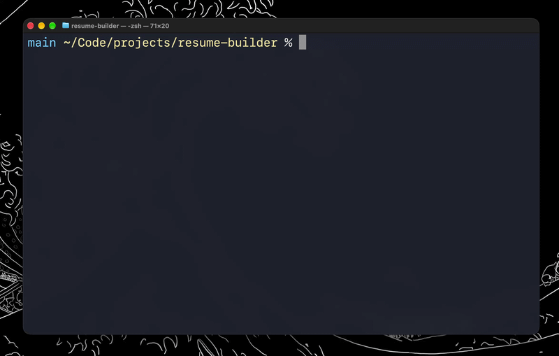
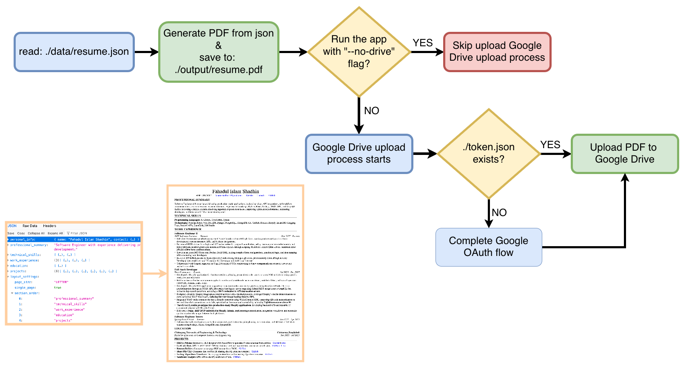

# Resume Builder

I built this to generate my one-page, Letter-size PDF resume from validated JSON data, using [uv](https://docs.astral.sh/uv/), Pydantic, and ReportLab.

[](https://www.python.org/)
[](https://docs.pydantic.dev/)
[](https://pypi.org/project/reportlab/)
[](https://docs.astral.sh/uv/)
[](https://developers.google.com/drive/api-reference/v3/about)

## Features

- **Validated input**: resume JSON is checked with Pydantic models before any PDF rendering happens; unknown fields are rejected.
- **One-page output**: enforce `settings.single_page` and fail with an actionable error instead of silently creating a multi-page resume.
- **Configurable layout**: page size (`LETTER` or `A4`) and section order come from the `settings` block in the JSON.
- **Quantified achievements**: experience responsibility metrics are rendered in bold alongside the text.
- **Google Drive delivery**: the generated PDF is uploaded to Google Drive after creation (skippable with `--no-drive`).

## Requirements

- Python 3.14 or newer
- [uv](https://docs.astral.sh/uv/)

## Getting started

```sh
uv sync
```

## Generate the resume

From the project directory:

```sh
uv run resume-builder
```

It reads `data/resume.json` and writes `output/resume.pdf`, with progress bars for the "Generating resume" and "Uploading resume" steps.

Skip uploading to Google Drive:

```sh
uv run resume-builder --no-drive
```

The resume JSON is validated against the models in `src/models.py`. The PDF uses the section order and page-size settings from the JSON. If `single_page` is enabled and the content does not fit, generation fails with an actionable error instead of creating a multi-page resume.

## Preview



## Google Drive upload

By default, this uploads my generated PDF to Google Drive using an OAuth 2.0 Desktop client.

Configure the following environment variables (e.g. in `.env`):

- `GOOGLE_DRIVE_CLIENT_ID` — Google Cloud OAuth 2.0 Desktop client ID
- `GOOGLE_DRIVE_CLIENT_SECRET` — Google Cloud OAuth 2.0 Desktop client secret
- `GOOGLE_DRIVE_TOKEN_PATH` — optional token file path (defaults to `token.json`)

The uploaded file name is configurable. Edit `DEFAULT_DRIVE_FILE_NAME` in `src/variables.py` to change it:

```python
DEFAULT_DRIVE_FILE_NAME = "Fahadul_Islam_Shadhin_Resume.pdf"
```

If credentials are missing or expired, the tool runs the local-server OAuth flow and stores the token for later use.

## Run tests

```sh
uv run python -m unittest discover -s tests -v
```

## Project structure



```text
resume-builder/
├── data/
│   ├── resume.json                        # Resume JSON used by default
├── output/                                # Generated PDF
│   └── resume.pdf
├── src/
│   ├── __init__.py
│   ├── __main__.py                        # `python -m src` entry point
│   ├── cli.py                             # Argument parsing and orchestration
│   ├── drive.py                           # Google Drive upload (OAuth + Drive API)
│   ├── models.py                          # Pydantic resume schema and field aliases
│   ├── pdf.py                             # ReportLab layout and PDF generation
│   ├── progress.py                        # Minimal single-line progress bar
│   └── variables.py                       # Default paths, Drive scopes, default Drive file name
├── tests/
│   ├── test_resume_builder.py
│   ├── test_drive.py
│   └── test_progress.py
├── pyproject.toml
└── README.md
```
